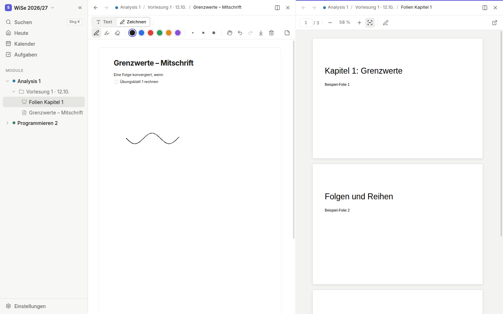
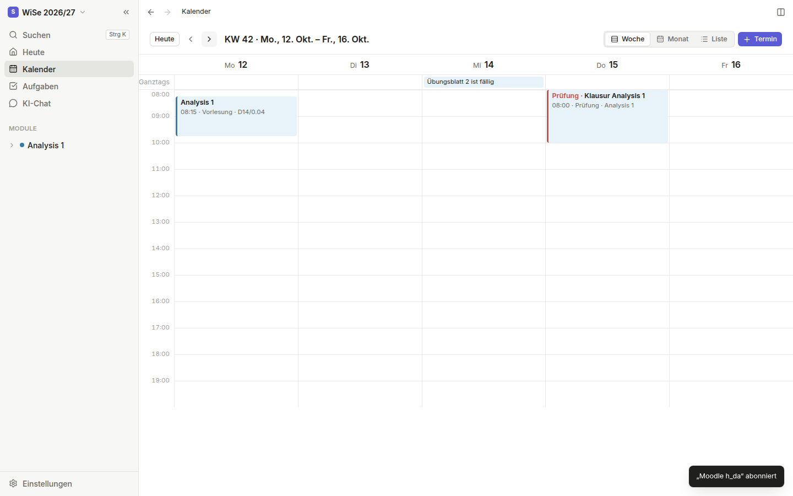
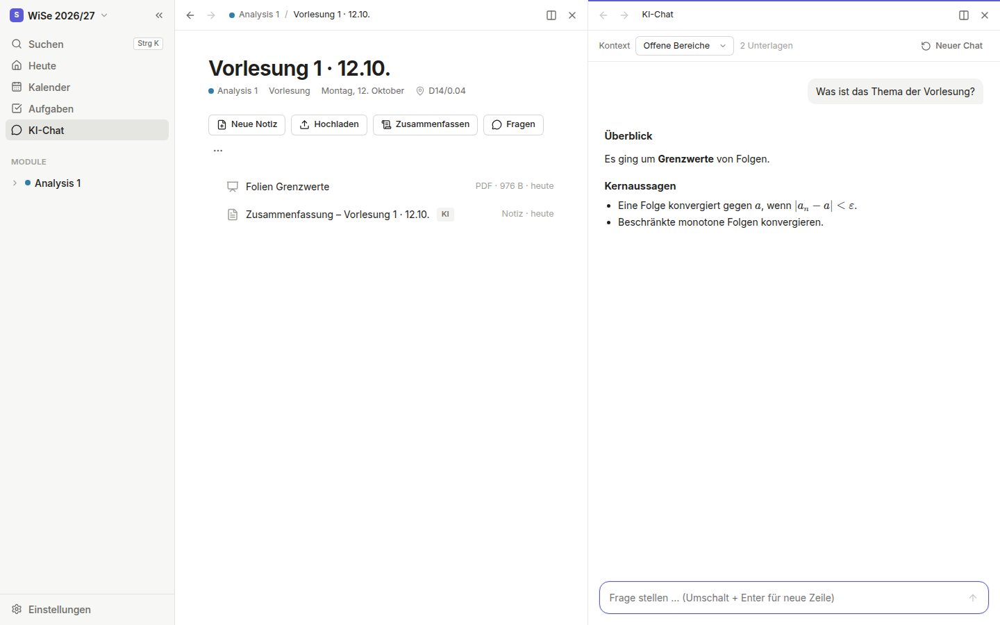

# Study Organizer

A calm, minimal organizer for your studies: semesters, modules, lectures with rooms, labs, handwritten notes, slides, videos, a calendar, and optional AI with your own API key. No account, no cloud: your data stays on your computer.

The app's interface is in German; labels quoted below are shown as they appear in the app, with an English translation in parentheses.



## Features

**Organize your studies**
- First-run setup: name, university, degree program, semester, modules. No login.
- Semester dates are built in for universities, universities of applied sciences (HAW/FH) and **h_da**. When a new semester starts, the app asks and can carry modules over.
- Modules with code, lecturer, ECTS, color and **weekly sessions including the room** (lecture, exercise, lab, seminar, tutorial; also biweekly, with cancellations and the Christmas break).
- **One folder per session at the push of a button** („Vorlesung 3 · 14.10.“, i.e. "Lecture 3 · Oct 14") for notes, slides, photos and videos.
- **Labs**: their own dates, pass status (passed/open) and submissions per module.
- **Tasks and submissions** with due dates, grouped into overdue, today, this week, …
- **Calendar** (week, month, list) automatically shows all lectures with rooms, exams, deadlines and labs.

**Notes like on a tablet**
- Notion-style editor with a slash menu (`/`): headings, lists, checklists, tables, code, quotes, **LaTeX formulas**, images.
- Fonts (sans, serif, book, mono, handwriting, high legibility), sizes, colors, highlighter.
- **Pen drawing** (pressure-sensitive), highlighter, eraser; „Nur Stift zeichnet“ (only the pen draws) for palm rejection.
- Paper: blank, lined, lined with margin, squared, dot grid, millimeter, Cornell, in white, cream, gray or dark.

**Files**
- View **PDF slides**, select and copy text, **write directly on the slides**.
- **Video and audio** at 0.5× to 3× speed, skipping, picture-in-picture; the playback position is remembered.
- Photos with zoom and rotation, text files; everything else opens in the default app.
- **Split screen with up to 4 panes**, e.g. slides, exercise sheet, note and AI chat at once. `Ctrl`/`⌘` + click opens side by side, or drag entries from the sidebar into a pane.

**Always up to date**
- **Moodle integration** (including university login/SSO): assignments become tasks, quizzes and course events appear in the calendar, course files on request.
- **Calendar subscriptions (iCal)** from Moodle, Stud.IP, ILIAS, the OBS of h_da computer science and others, synced regularly.
- **Import of .ics files** for systems without subscriptions (my h_da/HISinOne, TUCaN).

**AI (optional)**
- Only active if you enable it in the settings and enter an API key.
- **Summarize a lecture**, **all lectures so far** in a module, or **selected files**, as a new note.
- **Chat with your material**: the context is the open panes, a module, a folder or a selection.
- Providers: **Groq, Hugging Face, Google Gemini, Mistral, OpenRouter** (usable for free), **OpenAI, Anthropic, DeepSeek, xAI**, local **Ollama/LM Studio**, and any other OpenAI-compatible service.

<p>
  
  
</p>

## Installation

The installers are built automatically on GitHub.

1. On GitHub, open the **Releases** tab (published versions), or **Actions → "Installer packages" → latest run → Artifacts** (state of the latest push).
2. Download the file for your system.

### Windows (`.exe`)

1. Double-click `Study-Organizer-Setup-….exe`.
2. If Windows SmartScreen warns you ("Windows protected your PC"), click **More info → Run anyway** (on German systems: **Weitere Informationen → Trotzdem ausführen**). The warning appears because the app is not signed with a paid certificate.
3. Choose the installation folder → **Install**. The app then appears in the Start menu and on the desktop.

### macOS (`.dmg`)

1. Open `Study-Organizer-…-mac.dmg` and drag **Study Organizer** into the **Applications** folder.
2. On first launch, macOS reports an "unverified developer":
   - macOS 15 and later: **System Settings → Privacy & Security** → at the very bottom, **Open Anyway**.
   - Older versions: start it in Finder with **right-click → Open**.
3. If macOS says the app "is damaged", run this once in Terminal:
   ```bash
   xattr -cr "/Applications/Study Organizer.app"
   ```

The `.dmg` contains a universal app (Apple Silicon and Intel).

### Linux (`.AppImage`)

```bash
chmod +x Study-Organizer-*.AppImage
./Study-Organizer-*.AppImage
```

### Where is my data?

| System | Folder |
|---|---|
| Windows | `%APPDATA%\Study Organizer\data` |
| macOS | `~/Library/Application Support/Study Organizer/data` |
| Linux | `~/.config/Study Organizer/data` |

In **Einstellungen → Daten & Backup** (Settings → Data & backup) you can open the folder and create a backup (e.g. on a USB stick). API keys and Moodle access are stored encrypted in the system keychain and are not part of the backup.

## Moving your setup to another device

**Einstellungen → Geräte-Übertragung** (Settings → Device transfer) creates a `.studysetup` file that you can import on another device. A typical use: export on your PC, copy the file to your Android tablet, and import it there.

Choose how much the file contains:

| Scope | Contents | On import |
|---|---|---|
| „Einstellungen“ (settings) | Profile, settings, Moodle connection, AI, calendar subscriptions | Keeps the existing data on the target device |
| „+ Studium“ (+ studies) | Additionally semesters, modules, folders, calendar (including TUCaN imports), tasks, chats, Moodle forums | Replaces the data on the target device |
| „+ Notizen & Dateien“ (+ notes & files) | Additionally all notes, PDF annotations and files | Replaces the data on the target device |

- **Credentials** (Moodle token, AI keys, private calendar feed URLs) are only included if you enable the corresponding option.
- An optional **password** encrypts the file with AES-256-GCM (key derived with PBKDF2-SHA256, 250,000 iterations). Use one whenever the file contains credentials.

To import on the new device, either click **„Einrichtung importieren“** (import setup) on the onboarding welcome screen, or go to **Einstellungen → Geräte-Übertragung → „Datei wählen“** (choose file).

## Setting up AI (example: Groq, free)

1. Sign in at [console.groq.com/keys](https://console.groq.com/keys), click **Create API Key** and copy the key.
2. In the app: **Einstellungen → KI → Aktivieren** (Settings → AI → Enable), choose the service **Groq**, paste the key, **Speichern** (save).
3. Click **Testen** (test). Done: every lecture folder now offers **Zusammenfassen** (summarize) and **Fragen** (ask).

Other providers work the same way; under „Modell“ (model), **Modelle laden** (load models) fetches the available models. Privacy: for a summary, the selected notes and slide texts are sent to the provider. With Ollama, everything stays on your computer.

## Moodle and university calendars

Short version (details and sources in [docs/integrations.md](docs/integrations.md)):

- **Connect Moodle**: Einstellungen → Moodle & Kalender-Abos (Settings → Moodle & calendar subscriptions) → enter the address (e.g. `lernen.h-da.de`). The app detects whether a username/password or the university login (SSO) is required. Then map courses to modules and click **Jetzt abgleichen** (sync now).
- **Subscribe to the Moodle calendar**: in Moodle, Calendar → „Import und Export“ → „Kalender exportieren“ → „Alle Termine“ → „Kalender-URL abfragen“ (Import and export → Export calendar → All events → Get calendar URL) → paste the URL in the app under „Kalender abonnieren“ (subscribe to calendar).
- **my h_da**: timetable → „Daten für Kalender (ics) exportieren“ (export calendar data) → in the app, **iCal-Datei importieren** (import iCal file).

## Development

Prerequisites: [Node.js 22](https://nodejs.org) and [Git](https://git-scm.com).

```bash
# 1. Get the project
git clone https://github.com/souf1001/Study-Organizer.git
cd Study-Organizer

# 2. Install dependencies (also downloads Electron)
npm install

# 3. Start the app in development mode (reloads automatically on changes)
npm run dev
```

Other commands:

| Command | What it does |
|---|---|
| `npm run lint` | Checks the code for common mistakes (ESLint) |
| `npm run typecheck` | Checks the TypeScript types |
| `npm test` | Unit tests (Vitest): semesters, timetable, storage, iCal, Moodle, setup transfer |
| `npm run build` | Builds the app into `out/` |
| `npm run test:e2e` | Launches the real app and clicks through the main flows (Playwright); on Linux without a display: `xvfb-run -a npm run test:e2e` |
| `npm run dist:win` / `dist:mac` / `dist:linux` | Builds the installer for the given system into `release/` |

**Publishing a new version:** bump the version in `package.json`, commit, then

```bash
git tag v0.3.1
git push origin v0.3.1
```

GitHub then builds the `.exe`, `.dmg` and `.AppImage` and creates a release.

### Code structure

```
src/
  shared/     Data types and pure logic (semesters, timetable, AI providers, setup files), no dependencies
  backend/    Storage (JSON + files), AI calls, iCal, Moodle, setup transfer; runs in Node.js
  main/       Electron main process: windows, secure IPC, file protocol, keychain, Moodle SSO, TUCaN wizard
  preload/    Bridge to the UI (window.studyApi, see shared/api.ts)
  renderer/   React UI
    src/lib/     Data access, workspace (split screen), actions, AI context
    src/shell/   Sidebar, panes, command palette
    src/views/   Views: today, calendar, tasks, module, folder, note, files, chat, settings
    src/ui/      Building blocks: buttons, fields, dialogs, menus
tests/        Unit tests and end-to-end tests
```

Core principle: the UI talks to the data only through the interface in `src/shared/api.ts`. The desktop app implements it via IPC, the web version (branch `webapp`) via HTTP; the UI stays the same. See [docs/architecture.md](docs/architecture.md) for details.

### Security

- The UI runs in a sandbox without Node.js access (`contextIsolation`, `sandbox`) with a strict Content Security Policy.
- IPC only accepts requests from the app's own UI; IDs and file names are checked against path tricks.
- AI responses are sanitized before display (DOMPurify).
- API keys, Moodle tokens and calendar subscription addresses are encrypted with the system keychain (Electron `safeStorage`) and bound to the address they belong to.
- Links always open in the browser, never in the app window.

## License

MIT
